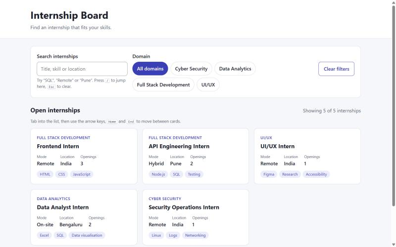
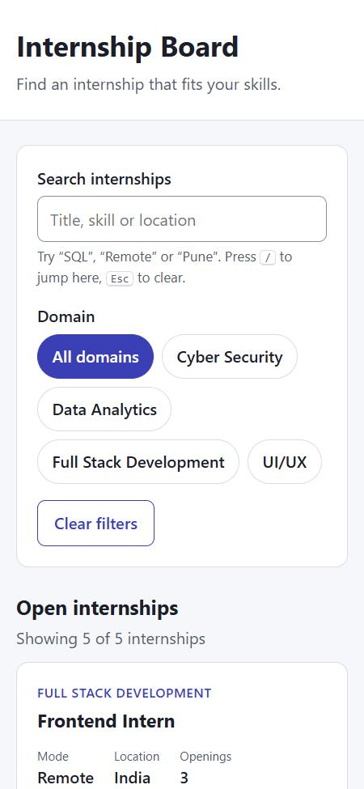
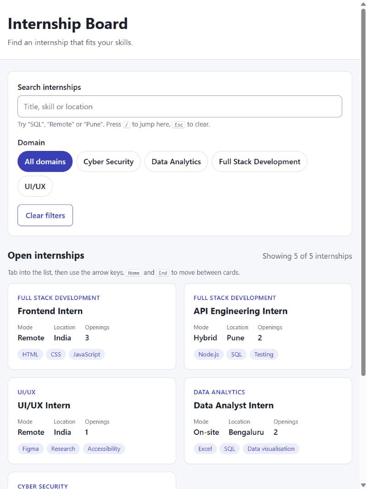

# Responsive Internship Board

An accessible internship listing page that works on mobile, tablet and desktop. It uses only HTML, CSS and vanilla JavaScript, with no framework and no build step.

**Track:** Full Stack Development · **Task:** Responsive Internship Board

## Live preview

| Host | URL |
| --- | --- |
| Vercel | https://responsive-internship-board.vercel.app |
| Render | https://responsive-internship-board-4g7g.onrender.com |

Append `?simulate=error` to either URL to see the error state.



## Short explanation

The page loads internship records from `data/internships.json` (the supplied seed file). For each record, `createCard()` in `js/app.js` builds a card. Search and the domain filter only change a small `state` object. After each change, `update()` filters the records and shows exactly one of four views: **loading**, **error** (with *Try again*), **empty** (with *Clear filters*) or **results**. The domain options are generated from the data, so a new domain in the JSON gets its own filter without code changes. Cards are built with `textContent`, so text in the data can't inject HTML.

## Passing checklist

- [x] **Plan the page structure and create reusable internship card data.** Semantic landmarks (`header`, `main`, `section`, `footer`), one heading per level, and data kept separate from the markup. A single `createCard()` function renders every card as `li > article` with a `dl` for the details and a list of skills.
- [x] **Build search and domain filters with empty and error states.** Multi-word search across title, domain, mode, location and skills (`remote sql` must match both words). Domain radio chips. A live "Showing X of Y" count. Empty state with a reset button. Error state with a retry button. Invalid records are skipped. Filters are disabled until data loads.
- [x] **Add keyboard navigation, form labels, and responsive layouts.** See below.
- [x] **One public link.** This repository (code, screenshots and this explanation) plus the live previews above.

## Accessibility

- **Skip link** to the listings that appears on the first <kbd>Tab</kbd>.
- **Labels:** the search box has a `<label>` plus `aria-describedby` hint text. Domain radios are grouped in a `<fieldset>` with a `<legend>`.
- **Keyboard navigation**
  - <kbd>/</kbd> moves focus to search, and <kbd>Esc</kbd> clears it.
  - Domain chips are real radio buttons, so the arrow keys move between them.
  - The card list uses a *roving tabindex*: a single <kbd>Tab</kbd> stop, then <kbd>←</kbd> <kbd>→</kbd> <kbd>↑</kbd> <kbd>↓</kbd>, <kbd>Home</kbd> and <kbd>End</kbd> move between cards. Up and down move one full row, whatever the column count.
- **Visible focus** rings (`:focus-visible`) on every interactive element and card.
- **Live regions:** the result count is `role="status"` and the error panel is `role="alert"`, so screen readers announce changes.
- At least **44px touch targets**, `prefers-color-scheme: dark` and `prefers-reduced-motion` are supported.

## Responsive testing (optional portfolio upgrade)

Tested in Chromium with device emulation:

| Width | Layout | Horizontal scroll | Result |
| --- | --- | --- | --- |
| **360px** (mobile) | 1 card column, filters stacked, chips wrap | None | ✅ Pass |
| **768px** (tablet) | 2 card columns, result count beside the heading | None | ✅ Pass |
| **1280px** (desktop) | 3 card columns, search + domains + reset on one row | None | ✅ Pass |

Also checked: keyword and domain filtering, the empty state and its reset, the error state (`?simulate=error`), arrow/Home/End card navigation, <kbd>Esc</kbd> to clear search, and dark mode.

| 360px | 768px |
| --- | --- |
|  |  |

Keyboard focus on a card: 

## Project structure

```
index.html              Page structure and state containers
css/styles.css          Mobile-first styles, breakpoints at 600px and 960px
js/app.js               Data loading, card rendering, filters, keyboard nav
data/internships.json   Supplied seed data (fictional)
vercel.json             Vercel config (static, security headers)
render.yaml             Render Blueprint (static site)
docs/screenshots/       Test screenshots
```

## Run locally

`fetch()` doesn't work from `file://`, so serve the folder:

```bash
python -m http.server 8080
# then open http://localhost:8080
```

## Deploy

Both hosts serve the repo root as a static site and redeploy on every push to `main`.

**Vercel:** go to [vercel.com/new](https://vercel.com/new), import this GitHub repo, set *Framework Preset* to **Other** and leave the build command empty, then click Deploy. `vercel.json` adds the headers.

**Render:** in the [Render dashboard](https://dashboard.render.com), choose **New → Blueprint**, pick this repo, and Render reads `render.yaml`. To set it up by hand instead, choose **New → Static Site**, leave the build command empty and set the publish directory to `.`.
