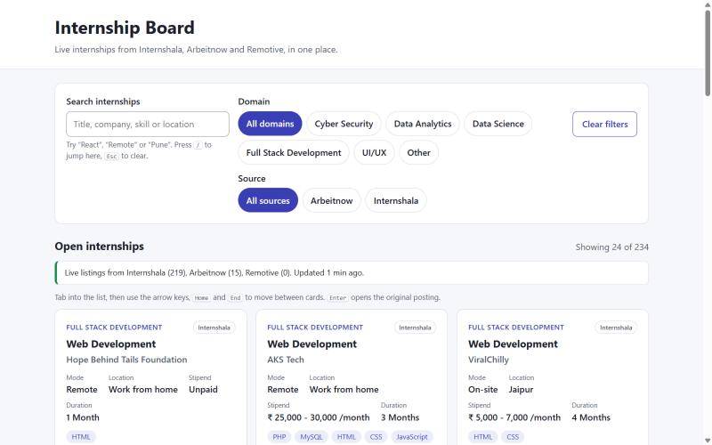
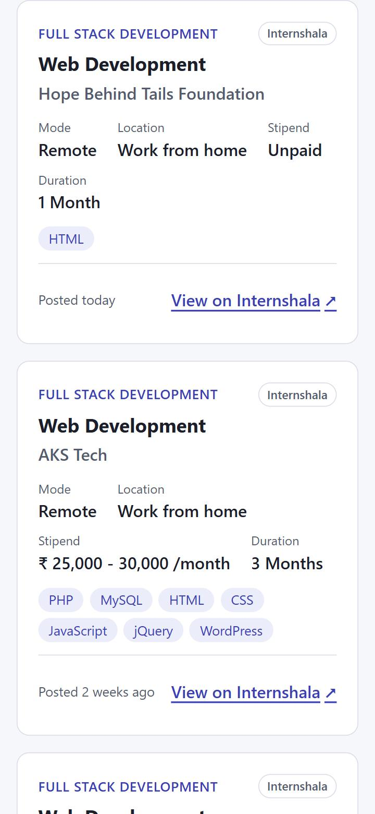
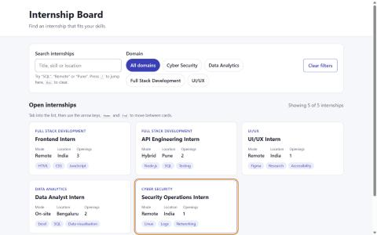

# Responsive Internship Board

An accessible internship board that shows **live internships from Internshala, Arbeitnow and Remotive**. It works on mobile, tablet and desktop. The frontend is plain HTML, CSS and vanilla JavaScript with no framework and no build step. One small serverless function collects the live listings.

**Track:** Full Stack Development · **Task:** Responsive Internship Board

## Live preview

| Host | URL |
| --- | --- |
| Vercel | https://responsive-internship-board.vercel.app |
| Render | https://responsive-internship-board-4g7g.onrender.com |

Try the fallbacks: `?simulate=offline` (live data fails, so sample data is shown) and `?simulate=error` (everything fails, so the error state is shown).



## Short explanation

`api/internships.js` is a Vercel serverless function. It fetches all three sources in parallel and converts each one into the same record shape (title, company, domain, mode, location, skills, stipend, duration, posted, link, source). It returns them as one JSON list, with a per-source status.

In the browser, `js/app.js` loads that list, and `createCard()` renders each record as a card that links back to the original posting. Search and the domain and source filters only change a small `state` object. After each change, `update()` filters the records and shows one of four views: **loading**, **error** (with *Try again*), **empty** (with *Clear filters*) or **results** (24 at a time, with *Show more*).

If the live API is unavailable, the page falls back to the supplied sample data in `data/internships.json` and says so. Cards are built with `textContent`, so scraped text can't inject HTML.

## Live data: sources and rules

No API keys are needed. Each source is used within what it allows:

| Source | How | What its rules say, and what we do |
| --- | --- | --- |
| **Internshala** | Scrapes 5 category pages (web dev, UI/UX, data analytics, data science, cyber security) with `cheerio` | `robots.txt` allows `/internships/<category>/` pages. It disallows `/internship/search/`, `/internship/details/` and URLs containing `?`, and we request none of those. |
| **Arbeitnow** | Free public job API, filtered to intern, praktikum, werkstudent and trainee titles | "Free public API, please do not abuse", with a link back. Every card links to the Arbeitnow posting. |
| **Remotive** | Free public job API, filtered to internship titles | Credit Remotive, link back, at most 4 calls a day. Cards link back, and the 6-hour cache keeps calls within the limit. It often has 0 internships; it's still checked on every refresh. |

**LinkedIn and Indeed are deliberately not scraped.** LinkedIn's `robots.txt` says automated access is "strictly prohibited" and blocks its guest jobs pages. Indeed disallows its job pages (`/job/`, `/jobs/IN/`) and its RSS feed, and uses bot detection. Both would need official API access.

**Being polite to the sources**
- **Caching:** the response is cached on Vercel's CDN for 6 hours (`s-maxage=21600, stale-while-revalidate`). However many people visit, each source is hit only a few times a day.
- **Honest identity:** the scraper sends the user agent `InternshipBoardBot/1.0` with a link to this repo, and doesn't pretend to be a browser.
- **Failures:** each source has a 15-second timeout and one retry on a dropped connection. If one source fails, the others are still shown, and the status line names the source that's unavailable.
- **Fragility:** scrapers break when a site changes its HTML. If that happens to Internshala, the board keeps working with the other sources, or with the sample data.

## Passing checklist

- [x] **Plan the page structure and create reusable internship card data.** Semantic landmarks, data kept separate from markup, and one normalized record shape for every source. A single `createCard()` renders every card as `li > article` with a `dl` of details, a skills list and a link back to the source.
- [x] **Build search and domain filters with empty and error states.** Multi-word search across title, company, domain, mode, location, source and skills. Domain and source radio chips generated from the data. A live result count. Loading, empty (with reset), error (with retry) and sample-data fallback states.
- [x] **Add keyboard navigation, form labels, and responsive layouts.** See below.
- [x] **One public link.** This repository (code, tests, screenshots and this explanation) plus the live previews above.

## Accessibility

- **Skip link** to the listings that appears on the first <kbd>Tab</kbd>.
- **Labels:** the search box has a `<label>` plus `aria-describedby` hint text. The domain and source radios are each grouped in a `<fieldset>` with a `<legend>`.
- **Keyboard navigation**
  - <kbd>/</kbd> moves focus to search, and <kbd>Esc</kbd> clears it.
  - Filter chips are real radio buttons, so the arrow keys move between them.
  - The card list uses a *roving tabindex*: a single <kbd>Tab</kbd> stop, then <kbd>←</kbd> <kbd>→</kbd> <kbd>↑</kbd> <kbd>↓</kbd>, <kbd>Home</kbd> and <kbd>End</kbd> move between cards. <kbd>Enter</kbd> opens the focused card's posting.
  - *Show more* moves focus to the first newly loaded card.
- **Links** say where they go, for example "View Web Development at Acme on Internshala (opens in a new tab)".
- **Visible focus** rings (`:focus-visible`) on every interactive element and card.
- **Live regions:** the result count and data-source status are `role="status"`, and the error panel is `role="alert"`.
- At least **44px touch targets**, `prefers-color-scheme: dark` and `prefers-reduced-motion` are supported.

## Testing

**Unit tests** (`npm test`, Node's built-in runner) cover the Internshala parser, using a synthetic fixture that copies the site's markup with made-up content. They also cover the Arbeitnow and Remotive filters and the normalizing helpers.

**Responsive testing** (optional portfolio upgrade), in Chromium with device emulation:

| Width | Layout | Horizontal scroll | Result |
| --- | --- | --- | --- |
| **360px** (mobile) | 1 card column, filters stacked, chips wrap | None | ✅ Pass |
| **768px** (tablet) | 2 card columns, result count beside the heading | None | ✅ Pass |
| **1280px** (desktop) | 3 card columns, search + filters + reset on one row | None | ✅ Pass |

Also checked:
- Live data in production: 234 internships (Internshala 219, Arbeitnow 15, Remotive 0), with a CDN cache HIT on repeat requests.
- Keyword, domain and source filtering, and the empty state and its reset.
- *Show more* focus, and Enter opening the posting.
- Both fallbacks (`?simulate=offline`, `?simulate=error`).
- Arrow, Home and End card navigation, Esc to clear search, and dark mode.

| 360px, live data | 768px |
| --- | --- |
|  |  |

Keyboard focus on a card: 

## Project structure

```
index.html                  Page structure and state containers
css/styles.css              Mobile-first styles, breakpoints at 600px and 960px
js/app.js                   Data loading + fallback, cards, filters, keyboard nav
api/internships.js          Serverless function: collects all sources, caching
lib/sources/internshala.js  Internshala category-page scraper (cheerio)
lib/sources/arbeitnow.js    Arbeitnow API client
lib/sources/remotive.js     Remotive API client
lib/normalize.js            Shared record shape and helpers
lib/http.js                 fetch with honest user agent, timeout and retry
data/internships.json       Supplied seed data (fictional), used as fallback
test/                       Unit tests and synthetic HTML fixture
scripts/dev-server.mjs      Local server that runs the API like Vercel does
vercel.json / render.yaml   Deploy config
```

## Run locally

Requires Node 18.17 or newer.

```bash
npm install
npm run dev     # http://localhost:3000, with live data
npm test        # unit tests
```

## Deploy

**Vercel** hosts the page and the `/api/internships` function, and redeploys on every push to `main`. To set it up: go to [vercel.com/new](https://vercel.com/new), import this repo, set *Framework Preset* to **Other**, and deploy.

**Render** hosts a static copy of the page. Static sites can't run functions, so this copy calls the Vercel API instead (the API sends `Access-Control-Allow-Origin: *`). To set it up: in the [Render dashboard](https://dashboard.render.com) choose **New → Blueprint**, pick this repo, and Render reads `render.yaml`. To redeploy on every push, the Render GitHub app must be connected to the repo.
